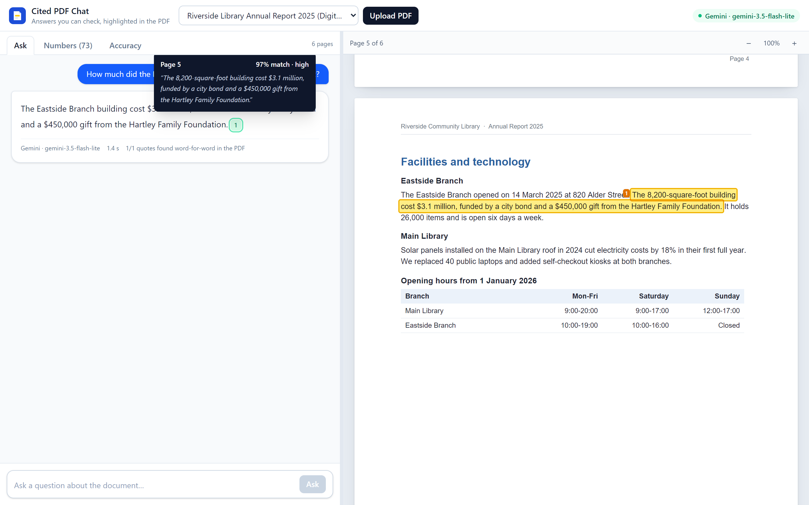
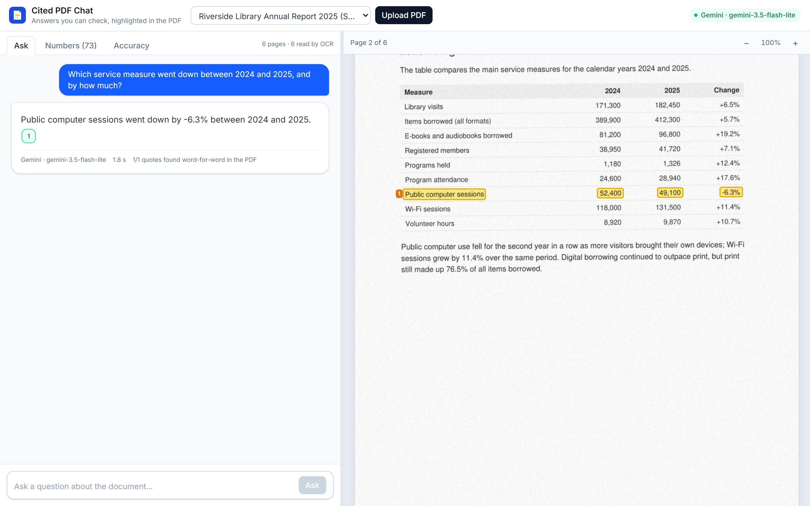

# Cited PDF Chat

Ask questions about a PDF, including a scanned one, and get answers you can check: every sentence links to the exact
text it came from, and that text is highlighted on the page. The model has to quote its source, and every quote is
matched against the PDF's own words, so a made-up citation is flagged instead of shown.

**Live demo: https://cited-pdf-chat.onrender.com** (free instance: after a quiet spell the first visit takes about a
minute to wake up).



## What it does

- **Answers with citations you can click.** Each sentence carries numbered citations. Click one and the PDF scrolls to
  the passage and highlights it. Hover to see the quoted text and its match score.
- **Quotes are verified, not trusted.** The model returns a verbatim quote per claim. The quote is aligned against the
  PDF's words (fuzzy, so OCR noise and curly quotes don't break it). If it can't be found, the citation is marked
  unverified and nothing is highlighted. If the model cited the wrong source, the right one is found.
- **Numbers guard.** A sentence whose numbers don't appear in the text it cites is flagged.
- **Says "not in this document"** instead of guessing, and shows the closest passages so you can check.
- **Scanned PDFs.** Pages without a text layer are OCR'd (PP-OCR via RapidOCR, English and Chinese) with word
  positions, so highlights land on the scanned image too. Dropped spaces ("TheSummerReadingChallenge") are restored.
- **Numbers tab.** Every figure in the document with what it measures, its sentence and page, found without AI so
  none are missed. Click a row to see it on the page; export to CSV.
- **Accuracy tab.** A built-in test set runs against a digital PDF and a scanned copy of it (see below).
- **Works without an API key.** No-key mode returns the best-matching passages instead of a written answer.



## How it works

```
PDF ──► PyMuPDF words + boxes ──┐
        (no text layer? OCR ────┤──► lines & paragraphs ──► chunks ──► hybrid search ──► top 6 chunks
         with word boxes)       │    (running headers        │          BM25 + bge-small
                                │     and footers dropped)   │          embeddings, RRF
                                │                            ▼
                                │                  LLM (Gemini by default) answers in JSON:
                                │                  sentences + verbatim quote per citation
                                │                            │
                                └──── word boxes ◄── quote aligned to the PDF's words ◄──┘
                                       │             (verified / partial / unverified, match score)
                                       ▼
                                 highlights in the PDF.js viewer
```

**Match score** (shown per citation) = 45% how exactly the model's quote matches the PDF text + 55% how much of the
sentence the quoted text supports (content-word overlap, or embedding similarity for faithful paraphrases). A quote
that can't be found is capped at 35. High is 80 and above, medium 60 to 79.

Stack: Python 3.12, FastAPI, PyMuPDF, RapidOCR (ONNX), fastembed (bge-small, local), React 19 + TypeScript, Vite,
Tailwind, PDF.js. Models: Gemini (default), Claude or OpenAI via `LLM_PROVIDER`. Busy (503) or rate-limited (429)
models are retried and then fall back to the next model in `GEMINI_FALLBACK_MODELS`.

## Accuracy

`eval/run_eval.py` asks 23 questions of the sample report (`samples/`), once as a normal PDF and once as an
image-only scanned copy. 19 questions have answers in the document and 4 don't. Results with `gemini-3.5-flash-lite`:

| Document | Correct | Declines when not in the document | Right page found by search | Citations on the right page | Avg time |
|---|---|---|---|---|---|
| Digital PDF | 23/23 | 4/4 | 100% | 100% | 2.4 s |
| Scanned copy (OCR) | 23/23 | 4/4 | 100% | 100% | 3.3 s |

This is a small test set on one document, not a benchmark. Run it on your own documents by adding them to
`eval/testset.json`. OCR word accuracy on the scanned copy, measured against the digital text, is about 95%, and all
72 figures in it are read correctly.

## Run it locally

```bash
# backend
cd backend
python -m venv .venv
.venv/Scripts/python -m pip install -r requirements.txt   # macOS/Linux: .venv/bin/python
cp ../.env.example ../.env                                 # add GEMINI_API_KEY (free at aistudio.google.com)
.venv/Scripts/python -m uvicorn app.main:app --port 8020

# frontend (dev server with hot reload, proxies /api to :8020)
cd frontend
npm install
npm run dev
```

`npm run build` puts the web app in `frontend/dist`, which the backend then serves at `/`, so one process is enough
in production. The sample PDFs are rebuilt with `python samples/make_samples.py` and indexed on first start.

Tests and the accuracy check:

```bash
cd backend && .venv/Scripts/python -m pytest
.venv/Scripts/python ../eval/run_eval.py            # uses the configured model
.venv/Scripts/python ../eval/run_eval.py --no-llm   # search-only mode
```

## Deploy

One container serves the API and the web app:

```bash
docker build -t cited-pdf-chat .
docker run -p 8000:8000 -e GEMINI_API_KEY=... -e RATE_LIMIT_PER_HOUR=30 cited-pdf-chat
```

It honours `$PORT`, so it runs as-is on Render, Railway, Fly.io or a Hugging Face Docker Space. The sample documents
and models are prepared during the build, so the first visitor doesn't wait.

The live demo runs on Render's free plan from `render.yaml` (a Blueprint): 30 questions an hour per visitor, 300
model answers a day, uploads deleted after 24 hours, and OCR off for uploads because the free instance has 512 MB
(the scanned sample is OCR'd during the build). It sleeps after 15 minutes without visitors, so the first visit then
takes about a minute. Memory measured locally: about 320 MB running, about 1 GB peak while OCR'ing a scan.

`deploy/huggingface/` builds the same app as a Hugging Face Docker Space (Docker Spaces need a paid plan).

## Configuration

| Variable | Default | |
|---|---|---|
| `LLM_PROVIDER` | `gemini` | `gemini`, `anthropic`, `openai` or `none` (search only) |
| `GEMINI_API_KEY` / `GEMINI_MODEL` | – / `gemini-3.5-flash-lite` | |
| `GEMINI_FALLBACK_MODELS` | `gemini-3.5-flash,gemini-flash-latest` | tried in order on 503/429 |
| `ANTHROPIC_API_KEY` / `ANTHROPIC_MODEL` | – / `claude-haiku-4-5-20251001` | |
| `OPENAI_API_KEY` / `OPENAI_MODEL` | – / `gpt-5-mini` | |
| `USE_EMBEDDINGS` | `1` | local embeddings for hybrid search (~70 MB model, downloaded once) |
| `MAX_UPLOAD_MB` / `MAX_PAGES` | `15` / `40` | upload limits |
| `RATE_LIMIT_PER_HOUR` | `0` (off) | questions + uploads per IP, for a public demo |
| `DAILY_LLM_LIMIT` | `0` (off) | model calls per day across all visitors; past it, answers fall back to search-only |
| `UPLOAD_TTL_HOURS` | `0` (keep) | uploaded PDFs are deleted after this many hours |
| `OCR_UPLOADS` | `1` | `0` skips scanned pages of uploads, for hosts with 512 MB (OCR of a scan peaks near 1 GB) |

## Limits

- Uploaded files are stored on the server's disk (deleted after `UPLOAD_TTL_HOURS` if set) and there are no
  accounts. Don't put confidential documents on a public demo.
- Highlights on OCR'd pages are per word, estimated from each text line's box.
- Reading order uses simple layout rules; complex multi-column layouts can mix columns.
- The sample report is fictional and was generated for this demo (`samples/make_samples.py`).
